# Model comparison

Every number comes from `reports/ml/results.json` (run `main`). Same data, same splits, same tuning budget, same latency procedure for every model.
Validation columns were used to choose; test columns were computed once and were not used to choose. Held-out Bal. Acc = mean balanced accuracy over leave-one-district-out and the two season-held-out fits. "Inference p50" is one sample per call on the CPU after warm-up (the same procedure for all models; tabular models read feature rows, sequence models read 32-step series, so the inputs differ by design).

## Healthy vs Problem  (`health_binary`)

| Model | Val Macro F1 | Val Bal. Acc | Test Accuracy | Test Bal. Acc | Test Macro F1 (95% CI) | Test Recall (macro) | Test ROC-AUC | Held-out Bal. Acc | Train time (s) | Inference p50 (ms) | Model size (MB) |
|---|---|---|---|---|---|---|---|---|---|---|---|
| random_forest | 0.542 | 0.543 | 0.702 | 0.499 | 0.499 (0.455-0.534) | 0.499 | 0.502 | 0.502 | 19 | 17.25 | 0.33 |
| lstm | 0.509 | 0.552 | 0.609 | 0.558 | 0.516 (0.470-0.554) | 0.558 | 0.548 | 0.512 | 28 | 1.91 | 0.03 |
| gru | 0.500 | 0.526 | 0.629 | 0.539 | 0.514 (0.471-0.550) | 0.539 | 0.569 | 0.503 | 71 | 2.46 | 0.02 |
| logistic_regression | 0.491 | 0.542 | 0.539 | 0.524 | 0.471 (0.433-0.509) | 0.524 | 0.522 | 0.503 | 3 | 0.12 | 0.00 |
| lightgbm | 0.491 | 0.492 | 0.665 | 0.489 | 0.488 (0.447-0.522) | 0.489 | 0.515 | 0.505 | 11 | 0.54 | 0.24 |
| mlp | 0.490 | 0.496 | 0.636 | 0.487 | 0.483 (0.449-0.524) | 0.487 | 0.508 | 0.483 | 10 | 0.64 | 0.02 |
| extra_trees | 0.489 | 0.492 | 0.695 | 0.535 | 0.530 (0.480-0.565) | 0.535 | 0.515 | 0.503 | 9 | 17.10 | 2.46 |
| xgboost | 0.484 | 0.485 | 0.720 | 0.499 | 0.498 (0.460-0.531) | 0.499 | 0.480 | 0.494 | 16 | 0.44 | 0.48 |
| hist_gradient_boosting | 0.482 | 0.484 | 0.682 | 0.523 | 0.518 (0.477-0.557) | 0.523 | 0.506 | 0.508 | 16 | 2.05 | 0.47 |
| catboost | 0.482 | 0.490 | 0.607 | 0.497 | 0.483 (0.438-0.523) | 0.497 | 0.467 | 0.511 | 41 | 0.55 | 0.07 |
| decision_tree | 0.472 | 0.568 | 0.463 | 0.449 | 0.406 (0.365-0.437) | 0.449 | 0.438 | 0.503 | 3 | 0.10 | 0.00 |
| knn | 0.456 | 0.495 | 0.808 | 0.500 | 0.465 (0.442-0.495) | 0.500 | 0.547 | 0.500 | 3 | 0.98 | 1.52 |
| majority_class (baseline) | 0.451 | 0.500 | 0.821 | 0.500 | 0.451 (0.441-0.459) | 0.500 | 0.500 | 0.500 | 0 | 0.00 | 0.00 |
| svm | 0.451 | 0.500 | 0.821 | 0.500 | 0.451 (0.441-0.459) | 0.500 | 0.483 | 0.500 | 30 | 0.31 | 1.46 |
| cnn1d | 0.436 | 0.483 | 0.508 | 0.493 | 0.444 (0.402-0.485) | 0.493 | 0.507 | 0.485 | 29 | 1.34 | 0.18 |
| tcn | 0.332 | 0.488 | 0.371 | 0.549 | 0.368 (0.330-0.408) | 0.549 | 0.556 | 0.507 | 62 | 1.47 | 0.03 |
| ndvi_rule (baseline) | 0.226 | 0.492 | 0.245 | 0.524 | 0.238 (0.207-0.266) | 0.524 | 0.524 | 0.502 | 0 | 0.02 | 0.00 |

* **Best overall model:** none: no model cleared the bar
* **Fastest reliable model:** none: no model is reliable enough to call fast
* **Best model for production deployment:** none: no model met the reliability bar and the deployment limits
* Top-ranked by the composite score, for reference only (not a winner; see the test column): decision_tree

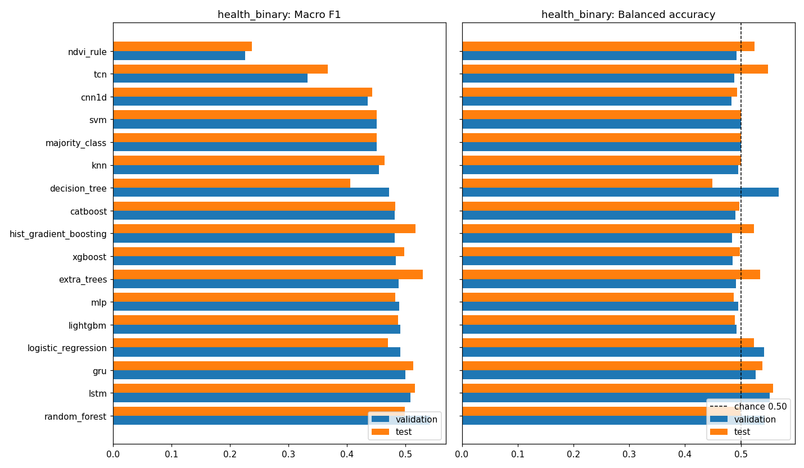
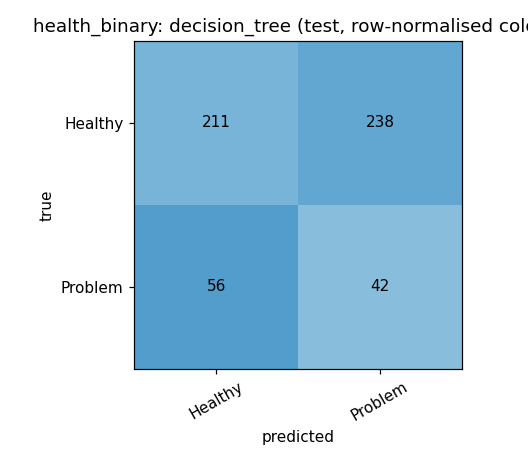
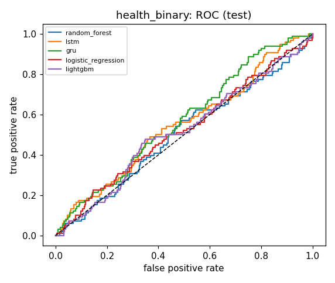
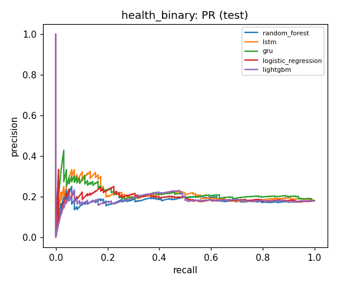
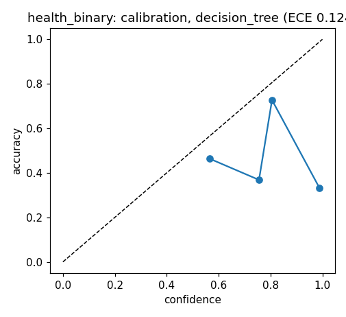
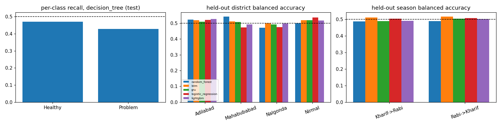

## Healthy / Pests / Diseased / Stressed  (`health_4class`)

| Model | Val Macro F1 | Val Bal. Acc | Test Accuracy | Test Bal. Acc | Test Macro F1 (95% CI) | Test Recall (macro) | Test ROC-AUC | Held-out Bal. Acc | Train time (s) | Inference p50 (ms) | Model size (MB) |
|---|---|---|---|---|---|---|---|---|---|---|---|
| catboost | 0.270 | 0.270 | 0.740 | 0.239 | 0.232 (0.211-0.262) | 0.239 | 0.503 | 0.253 | 216 | 0.79 | 1.01 |
| xgboost | 0.268 | 0.289 | 0.548 | 0.236 | 0.231 (0.195-0.261) | 0.236 | 0.490 | 0.251 | 69 | 1.12 | 0.88 |
| hist_gradient_boosting | 0.256 | 0.256 | 0.726 | 0.248 | 0.246 (0.216-0.283) | 0.248 | 0.492 | 0.247 | 65 | 4.10 | 0.80 |
| extra_trees | 0.246 | 0.249 | 0.702 | 0.249 | 0.248 (0.215-0.280) | 0.249 | 0.520 | 0.254 | 17 | 33.75 | 4.27 |
| random_forest | 0.244 | 0.242 | 0.686 | 0.260 | 0.259 (0.216-0.294) | 0.260 | 0.505 | 0.261 | 32 | 33.45 | 1.34 |
| decision_tree | 0.242 | 0.313 | 0.402 | 0.278 | 0.225 (0.191-0.267) | 0.278 | 0.492 | 0.270 | 6 | 0.37 | 0.03 |
| lightgbm | 0.233 | 0.241 | 0.753 | 0.264 | 0.266 (0.222-0.300) | 0.264 | 0.508 | 0.251 | 40 | 0.55 | 1.72 |
| knn | 0.225 | 0.250 | 0.821 | 0.250 | 0.225 (0.221-0.230) | 0.250 | 0.506 | 0.250 | 3 | 0.75 | 1.52 |
| majority_class (baseline) | 0.225 | 0.250 | 0.821 | 0.250 | 0.225 (0.221-0.230) | 0.250 | 0.500 | 0.250 | 0 | 0.00 | 0.00 |
| svm | 0.225 | 0.250 | 0.821 | 0.250 | 0.225 (0.221-0.230) | 0.250 | 0.463 | 0.250 | 69 | 0.67 | 1.61 |
| cnn1d | 0.203 | 0.245 | 0.399 | 0.218 | 0.198 (0.171-0.231) | 0.218 | 0.490 | 0.252 | 16 | 0.93 | 0.18 |
| logistic_regression | 0.176 | 0.316 | 0.225 | 0.293 | 0.171 (0.145-0.198) | 0.293 | 0.523 | 0.250 | 6 | 0.41 | 0.01 |
| gru | 0.163 | 0.254 | 0.239 | 0.250 | 0.163 (0.132-0.192) | 0.250 | 0.488 | 0.274 | 39 | 1.91 | 0.02 |
| lstm | 0.143 | 0.254 | 0.188 | 0.261 | 0.140 (0.115-0.173) | 0.261 | 0.517 | 0.251 | 14 | 1.27 | 0.03 |
| tcn | 0.124 | 0.271 | 0.146 | 0.231 | 0.118 (0.094-0.142) | 0.231 | 0.480 | 0.257 | 62 | 2.38 | 0.10 |
| mlp | 0.103 | 0.272 | 0.082 | 0.249 | 0.090 (0.068-0.116) | 0.249 | 0.493 | 0.257 | 2 | 0.27 | 0.01 |

* **Best overall model:** none: no model cleared the bar
* **Fastest reliable model:** none: no model is reliable enough to call fast
* **Best model for production deployment:** none: no model met the reliability bar and the deployment limits
* Top-ranked by the composite score, for reference only (not a winner; see the test column): decision_tree

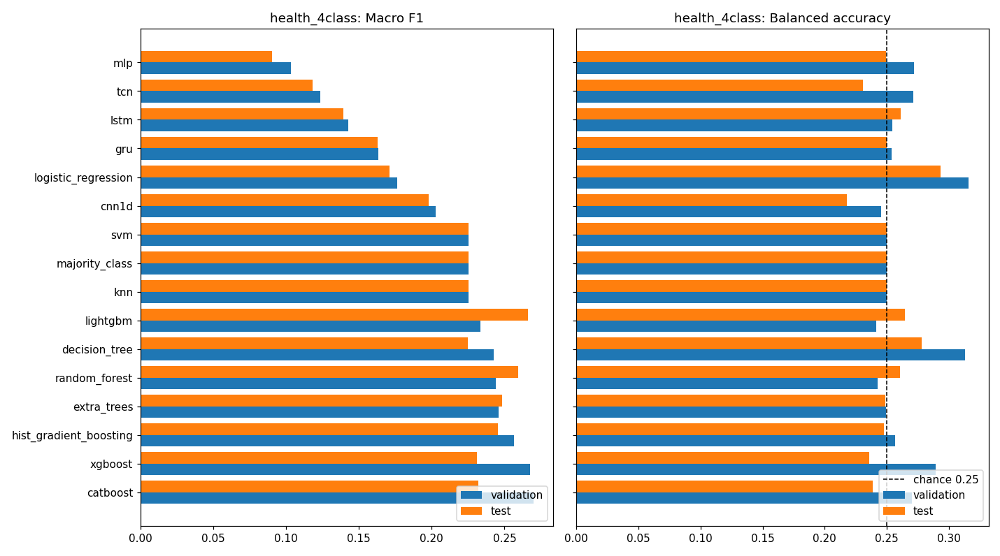
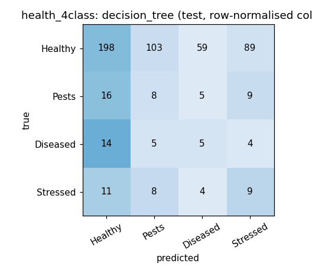
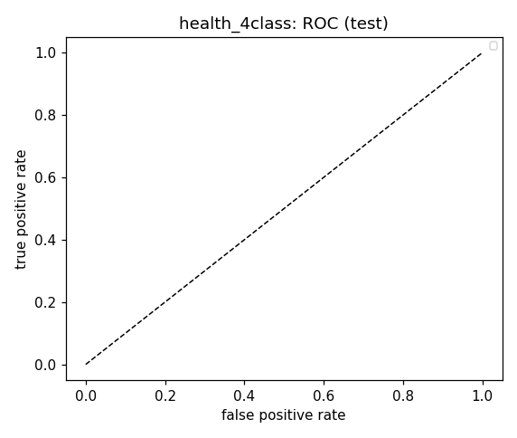
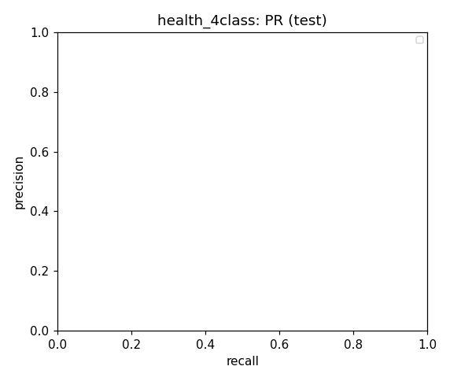
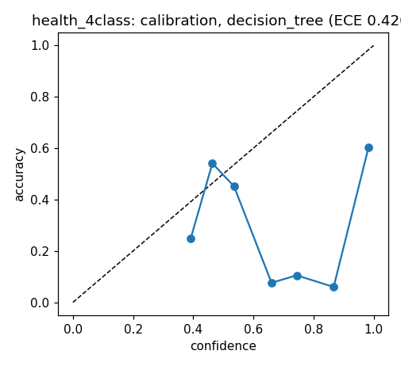
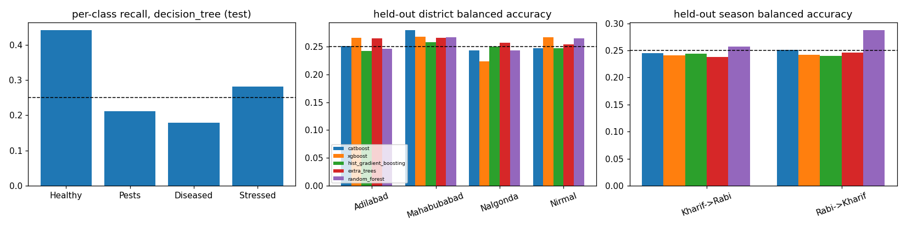

## Cause among problem fields (Pests / Diseased / Stressed)  (`stress_cause`)

| Model | Val Macro F1 | Val Bal. Acc | Test Accuracy | Test Bal. Acc | Test Macro F1 (95% CI) | Test Recall (macro) | Test ROC-AUC | Held-out Bal. Acc | Train time (s) | Inference p50 (ms) | Model size (MB) |
|---|---|---|---|---|---|---|---|---|---|---|---|
| xgboost | 0.456 | 0.456 | 0.408 | 0.397 | 0.399 (0.304-0.489) | 0.397 | 0.551 | 0.361 | 26 | 0.60 | 0.83 |
| lightgbm | 0.403 | 0.403 | 0.418 | 0.412 | 0.413 (0.319-0.516) | 0.412 | 0.555 | 0.350 | 14 | 0.64 | 0.55 |
| catboost | 0.396 | 0.401 | 0.418 | 0.412 | 0.411 (0.312-0.496) | 0.412 | 0.524 | 0.347 | 182 | 1.16 | 0.22 |
| knn | 0.394 | 0.399 | 0.367 | 0.360 | 0.357 (0.265-0.453) | 0.360 | 0.523 | 0.341 | 2 | 5.92 | 0.28 |
| random_forest | 0.365 | 0.367 | 0.408 | 0.400 | 0.400 (0.331-0.500) | 0.400 | 0.504 | 0.342 | 18 | 31.97 | 0.82 |
| lstm | 0.359 | 0.360 | 0.337 | 0.332 | 0.332 (0.242-0.421) | 0.332 | 0.469 | 0.333 | 4 | 1.45 | 0.03 |
| tcn | 0.348 | 0.344 | 0.306 | 0.287 | 0.277 (0.196-0.375) | 0.287 | 0.466 | 0.352 | 9 | 2.01 | 0.03 |
| hist_gradient_boosting | 0.346 | 0.344 | 0.418 | 0.420 | 0.417 (0.322-0.500) | 0.420 | 0.555 | 0.317 | 65 | 5.20 | 0.36 |
| extra_trees | 0.337 | 0.347 | 0.347 | 0.348 | 0.346 (0.247-0.436) | 0.348 | 0.481 | 0.308 | 10 | 29.58 | 0.49 |
| decision_tree | 0.320 | 0.335 | 0.378 | 0.363 | 0.355 (0.276-0.442) | 0.363 | 0.545 | 0.328 | 2 | 0.14 | 0.00 |
| logistic_regression | 0.305 | 0.304 | 0.357 | 0.355 | 0.354 (0.264-0.436) | 0.355 | 0.479 | 0.328 | 3 | 0.24 | 0.01 |
| cnn1d | 0.291 | 0.298 | 0.327 | 0.321 | 0.323 (0.235-0.416) | 0.321 | 0.500 | 0.348 | 3 | 0.94 | 0.18 |
| mlp | 0.289 | 0.291 | 0.367 | 0.353 | 0.349 (0.261-0.452) | 0.353 | 0.480 | 0.344 | 1 | 0.54 | 0.02 |
| gru | 0.259 | 0.315 | 0.327 | 0.317 | 0.272 (0.202-0.336) | 0.317 | 0.445 | 0.333 | 11 | 3.67 | 0.05 |
| svm | 0.188 | 0.257 | 0.347 | 0.317 | 0.244 (0.170-0.318) | 0.317 | 0.478 | 0.329 | 8 | 0.91 | 0.29 |
| majority_class (baseline) | 0.179 | 0.333 | 0.388 | 0.333 | 0.186 (0.148-0.213) | 0.333 | 0.500 | 0.333 | 0 | 0.01 | 0.00 |

* **Best overall model:** none: no model cleared the bar
* **Fastest reliable model:** none: no model is reliable enough to call fast
* **Best model for production deployment:** none: no model met the reliability bar and the deployment limits
* Top-ranked by the composite score, for reference only (not a winner; see the test column): xgboost

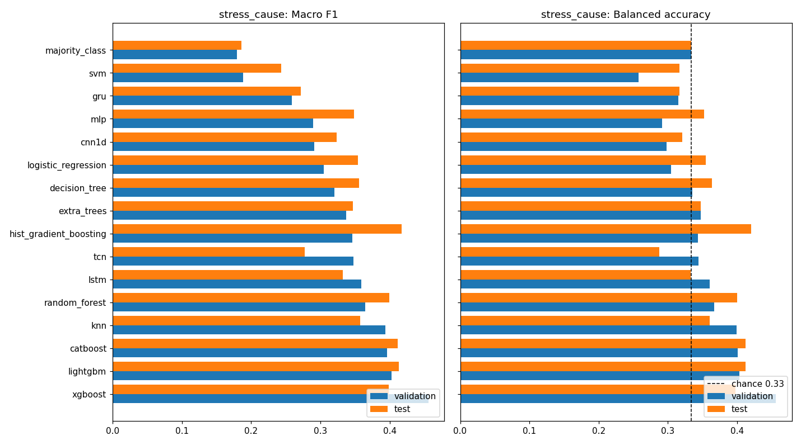
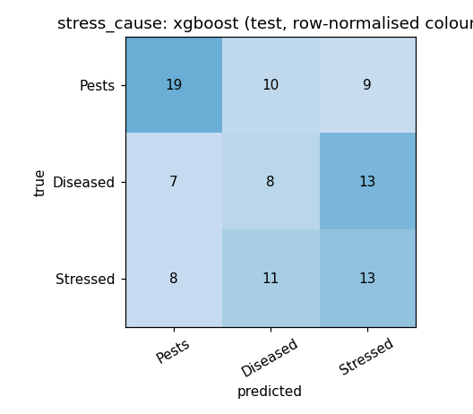
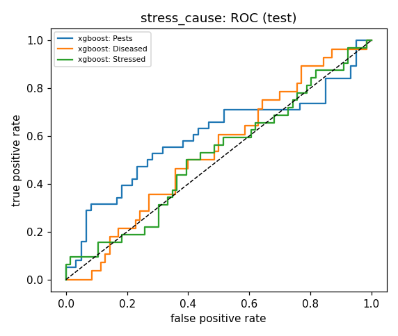
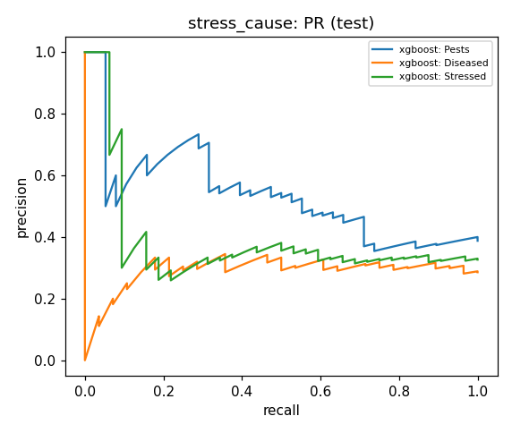
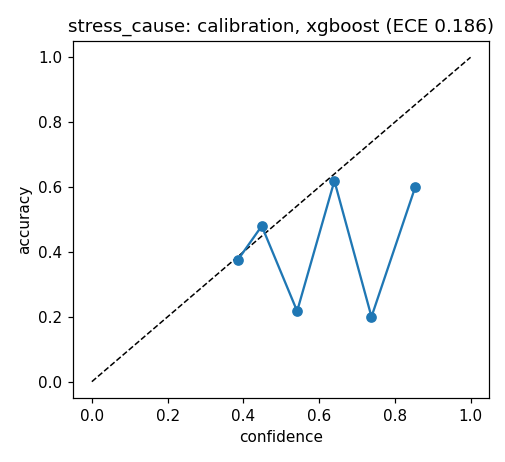
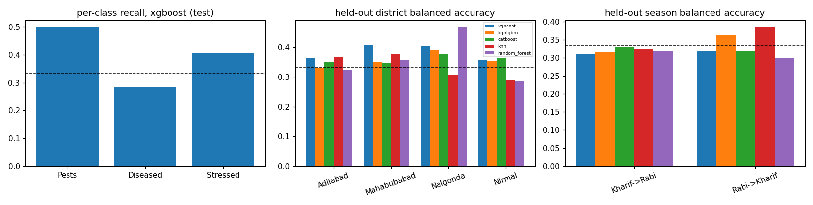

## Overall

**Healthy vs Problem**: the model ranked highest by the composite score is **decision_tree** (validation macro-F1 0.472, balanced accuracy 0.568, 95% interval 0.521 to 0.626; chance is 0.50; test balanced accuracy 0.449); on held-out districts and the other season it averages 0.503 balanced accuracy. It does **not** clear the pre-registered bar (the validation interval includes chance or held-out balanced accuracy is not at least chance + 0.03), so it is reported as the top-ranked attempt, not as a winner. When every model sits at chance, the ranking mostly reflects speed, size and validation noise. The always-answer-the-commonest-class baseline scores macro-F1 0.451 and accuracy 0.821 on the test split.

**Healthy / Pests / Diseased / Stressed**: the model ranked highest by the composite score is **decision_tree** (validation macro-F1 0.242, balanced accuracy 0.313, 95% interval 0.253 to 0.385; chance is 0.25; test balanced accuracy 0.278); on held-out districts and the other season it averages 0.270 balanced accuracy. It does **not** clear the pre-registered bar (the validation interval includes chance or held-out balanced accuracy is not at least chance + 0.03), so it is reported as the top-ranked attempt, not as a winner. When every model sits at chance, the ranking mostly reflects speed, size and validation noise. The always-answer-the-commonest-class baseline scores macro-F1 0.225 and accuracy 0.821 on the test split.

**Cause among problem fields (Pests / Diseased / Stressed)**: the model ranked highest by the composite score is **xgboost** (validation macro-F1 0.456, balanced accuracy 0.456, 95% interval 0.370 to 0.570; chance is 0.33; test balanced accuracy 0.397); on held-out districts and the other season it averages 0.361 balanced accuracy. It does **not** clear the pre-registered bar (the validation interval includes chance or held-out balanced accuracy is not at least chance + 0.03), so it is reported as the top-ranked attempt, not as a winner. When every model sits at chance, the ranking mostly reflects speed, size and validation noise. The always-answer-the-commonest-class baseline scores macro-F1 0.186 and accuracy 0.388 on the test split.

Models that did not run (failed, not applicable or skipped by design):

| Task | Model | Status | Detail |
|---|---|---|---|
| health_4class | ndvi_rule | not_applicable | the app rule only separates alert / no alert; it cannot name a cause or a class |
| stress_cause | ndvi_rule | not_applicable | the app rule only separates alert / no alert; it cannot name a cause or a class |
| all | transformer | skipped by design | dataset too small (3,644 fields) and tree models already sit at chance |
