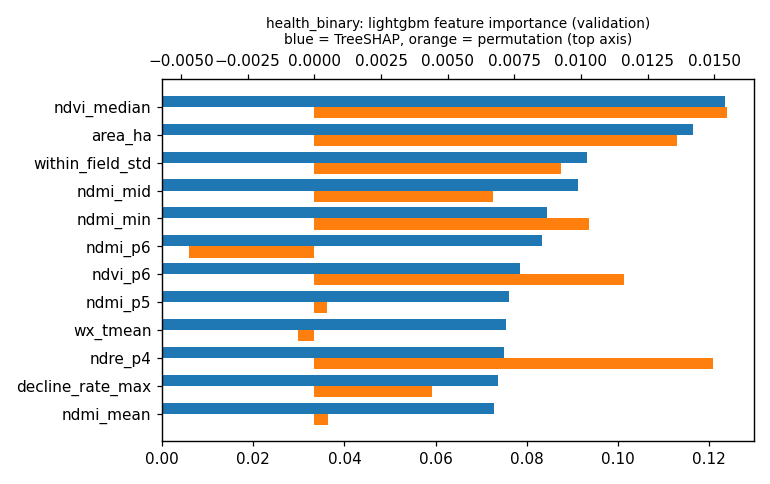
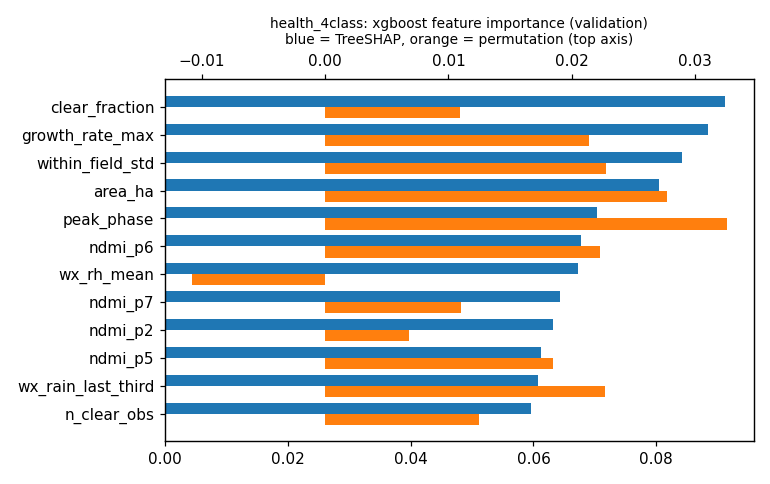
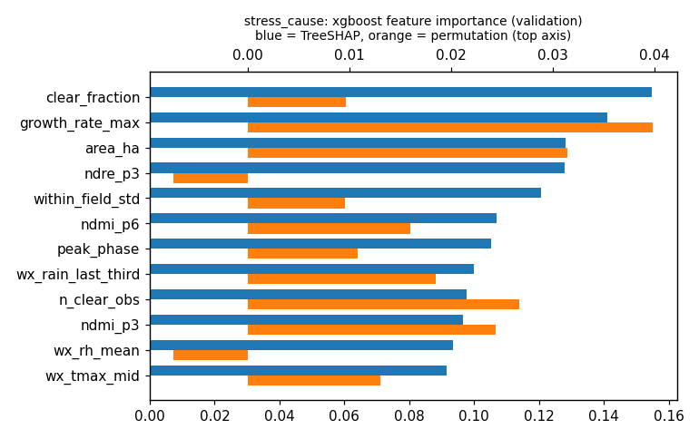

# Training report

## What was run

Ten classical models, five deep models and two baselines were trained on the Telangana Crop Health data (the only dataset in the repository with stress labels), for three tasks. All settings are in `configs/ml/`. Results: `reports/ml/results.json`.

## Setup

* Hardware: AMD64 Family 25 Model 124 Stepping 0, AuthenticAMD, 12 logical cores, 15.2 GB RAM; GPU present: NVIDIA GeForce RTX 4050 Laptop GPU, 6141 MiB. **GPU used in training: no.** PyTorch is `2.14.1+cpu` (CUDA available: False); XGBoost, LightGBM, CatBoost and scikit-learn ran on the CPU.
* Libraries: {'numpy': '2.4.6', 'scikit-learn': '1.5.1', 'xgboost': '3.2.0', 'lightgbm': '4.7.0', 'catboost': '1.2.10', 'optuna': '5.1.0', 'torch': '2.14.1+cpu', 'pandas': '3.1.1'}
* Seed: 42 everywhere (splits, Optuna, model seeds). Split: 70 / 15 / 15 by field (see VALIDATION_REPORT.md).
* Tuning: Optuna TPE, 12 trials for classical models with 3-fold CV on the training rows (objective: macro-F1), 4 trials for deep models on one hold-out of the training rows; early stopping on a hold-out of the training rows. Search spaces are small on purpose: with about 2,500 training rows more tuning would fit noise.
* Class imbalance: balanced class weights (or inverse-frequency loss weights for the deep models).
* Held-out districts and the other season are scored with **nested tuning**: the settings for each fold are searched on that fold's own training rows (2 trials, 2-fold CV for classical models; 1 trial for deep), so the held-out data never influenced them.
* Baselines: the always-answer-the-commonest-class model, and the app's real alert (shared/evidence.ts + advice.ts) replayed on every field by `scripts/evaluate-telangana-alerts.mjs` (Healthy vs Problem only).
* Skipped by design: transformer (dataset too small (3,644 fields) and tree models already sit at chance)

## Results at a glance

**Healthy vs Problem**: the model ranked highest by the composite score is **logistic_regression** (validation macro-F1 0.491, balanced accuracy 0.542, 95% interval 0.488 to 0.592; chance is 0.50; test balanced accuracy 0.524); on held-out districts and the other season it averages 0.508 balanced accuracy. It does **not** clear the pre-registered bar (the validation interval includes chance or held-out balanced accuracy is not at least chance + 0.03), so it is reported as the top-ranked attempt, not as a winner. When every model sits at chance, the ranking mostly reflects speed, size and validation noise. The always-answer-the-commonest-class baseline scores macro-F1 0.451 and accuracy 0.821 on the test split.

**Healthy / Pests / Diseased / Stressed**: the model ranked highest by the composite score is **logistic_regression** (validation macro-F1 0.176, balanced accuracy 0.316, 95% interval 0.253 to 0.383; chance is 0.25; test balanced accuracy 0.293); on held-out districts and the other season it averages 0.246 balanced accuracy. It does **not** clear the pre-registered bar (the validation interval includes chance or held-out balanced accuracy is not at least chance + 0.03), so it is reported as the top-ranked attempt, not as a winner. When every model sits at chance, the ranking mostly reflects speed, size and validation noise. The always-answer-the-commonest-class baseline scores macro-F1 0.225 and accuracy 0.821 on the test split.

**Cause among problem fields (Pests / Diseased / Stressed)**: the model ranked highest by the composite score is **xgboost** (validation macro-F1 0.456, balanced accuracy 0.456, 95% interval 0.370 to 0.570; chance is 0.33; test balanced accuracy 0.397); on held-out districts and the other season it averages 0.345 balanced accuracy. It does **not** clear the pre-registered bar (the validation interval includes chance or held-out balanced accuracy is not at least chance + 0.03), so it is reported as the top-ranked attempt, not as a winner. When every model sits at chance, the ranking mostly reflects speed, size and validation noise. The always-answer-the-commonest-class baseline scores macro-F1 0.186 and accuracy 0.388 on the test split.

## Tuned settings, time and memory (Healthy vs Problem)

| Model | Best settings | Trials | Train time (s) | Peak RAM (MB) | GPU used | Inference p50 / p95 (ms) | Samples/s (batch 256) | Size (MB) |
|---|---|---|---|---|---|---|---|---|
| catboost | {'iterations': 300, 'depth': 3, 'learning_rate': 0.04411829935614202, 'l2_leaf_reg': 2.324672848950434} | 12 | 44 | 579 | False | 0.44 / 0.60 | 185351 | 0.067 |
| cnn1d | {'dropout': 0.12323344486727979, 'lr': 0.007348118405270454, 'weight_decay': 0.0006358358856676254, 'channels': 64} | 4 | 14 | 449 | False | 0.45 / 0.77 | 38881 | 0.182 |
| decision_tree | {'max_depth': 4, 'min_samples_leaf': 15} | 12 | 4 | 324 | False | 0.11 / 0.14 | 1088158 | 0.004 |
| extra_trees | {'n_estimators': 150, 'max_depth': 16, 'min_samples_leaf': 15, 'max_features': 'sqrt'} | 12 | 11 | 332 | False | 29.58 / 32.26 | 6822 | 2.464 |
| gru | {'dropout': 0.4464704583099741, 'lr': 0.003991305878561679, 'weight_decay': 0.001331121608073689, 'hidden': 32, 'layers': 1} | 4 | 35 | 559 | False | 0.93 / 1.53 | 36504 | 0.022 |
| hist_gradient_boosting | {'max_depth': 6, 'learning_rate': 0.020547810139558063, 'max_iter': 200, 'l2_regularization': 0.022915785302799044, 'min_samples_leaf': 42} | 12 | 16 | 577 | False | 1.82 / 3.16 | 80902 | 0.467 |
| knn | {'n_neighbors': 7, 'weights': 'uniform'} | 12 | 3 | 588 | False | 0.41 / 0.79 | 77076 | 1.521 |
| lightgbm | {'n_estimators': 300, 'num_leaves': 6, 'learning_rate': 0.10364734587283783, 'min_child_samples': 14, 'subsample': 0.6260206371941118, 'colsample_bytree': 0.9744427686266666, 'reg_lambda': 8.536189862866832} | 12 | 13 | 534 | False | 0.42 / 0.61 | 241687 | 0.236 |
| logistic_regression | {'C': 0.004207988669606638} | 12 | 3 | 318 | False | 0.14 / 0.23 | 765550 | 0.004 |
| lstm | {'dropout': 0.4464704583099741, 'lr': 0.003991305878561679, 'weight_decay': 0.001331121608073689, 'hidden': 32, 'layers': 1} | 4 | 14 | 504 | False | 0.59 / 1.09 | 117889 | 0.027 |
| majority_class | {} | 0 | 0 | 279 | False | 0.00 / 0.00 | 10070810 | 0.000 |
| mlp | {'dropout': 0.17272998688284025, 'lr': 0.0015254729458052604, 'weight_decay': 8.17949947521167e-05, 'hidden': 32, 'layers': 2} | 4 | 6 | 400 | False | 0.26 / 0.42 | 313211 | 0.016 |
| ndvi_rule | {} | 0 | 0 | 283 | False | 0.01 / 0.01 | 1414990 | 0.066 |
| random_forest | {'n_estimators': 100, 'max_depth': 5, 'min_samples_leaf': 7, 'max_features': 0.5} | 12 | 22 | 328 | False | 18.99 / 20.72 | 8572 | 0.333 |
| svm | {'C': 0.8468008575248331, 'gamma': 0.07114476009343425} | 12 | 34 | 573 | False | 0.38 / 0.69 | 4934 | 1.461 |
| tcn | {'dropout': 0.249816047538945, 'lr': 0.00892718030435363, 'weight_decay': 0.001570297088405539, 'channels': 16, 'levels': 3} | 4 | 33 | 579 | False | 0.97 / 2.08 | 37439 | 0.025 |
| xgboost | {'n_estimators': 400, 'max_depth': 5, 'learning_rate': 0.13607801490147406, 'subsample': 0.608233797718321, 'colsample_bytree': 0.9849549260809971, 'min_child_weight': 17, 'reg_lambda': 0.26587543983272705} | 12 | 17 | 459 | False | 0.44 / 1.08 | 154009 | 0.475 |

Peak RAM is the whole Python process (including loaded libraries), sampled every 50 ms during tuning and fitting. Settings for the other two tasks are in `reports/ml/results.json`.

## Explainability

Exact TreeSHAP values (LightGBM / XGBoost native; `shap` failed to import once under a Windows Application Control policy, but imports now and `shap.TreeExplainer` matches the native values exactly, see FINAL_VERIFICATION_REPORT.md) and permutation importance on the validation split. These are satellite indicators that moved a model score; **they are not evidence of a disease or pest**, and when the model itself is near chance they mostly describe noise.

**Healthy vs Problem** (lightgbm) top indicators: ndvi_median (0.124), area_ha (0.116), within_field_std (0.093), ndmi_mid (0.091), ndmi_min (0.084), ndmi_p6 (0.083).


**Healthy / Pests / Diseased / Stressed** (xgboost) top indicators: clear_fraction (0.091), growth_rate_max (0.088), within_field_std (0.084), area_ha (0.081), peak_phase (0.070), ndmi_p6 (0.068).


**Cause among problem fields (Pests / Diseased / Stressed)** (xgboost) top indicators: clear_fraction (0.155), growth_rate_max (0.141), area_ha (0.128), ndre_p3 (0.128), within_field_std (0.121), ndmi_p6 (0.107).


## Known limitations

* One dataset, one region (Telangana), one season (99% sown in 2023), one label per field per season from a survey that was not independently verified. No severity labels.
* The satellite extract holds NDVI, NDRE and NDMI only (cloud-masked). NDWI and EVI cannot be built; raw bands were not stored; there is no soil-moisture source.
* Deep models were tuned with 4 trials on a single hold-out; a bigger search might shift them slightly, but with no signal in the labels it cannot create one.
* Latency compares tabular and sequence inputs because that is what each model type consumes.

## Reproduce

```
.venv/Scripts/python scripts/ml/run_all_experiments.py            # everything, resumable
.venv/Scripts/python scripts/ml/run_all_experiments.py --force    # redo every model
.venv/Scripts/python scripts/ml/run_all_experiments.py --quick    # smoke test only, do not report
cd scripts/ml && ../../.venv/Scripts/python -m unittest test_ml_pipeline
```

Inputs are the git-ignored `.local/datasets/labelled/*` files listed in `configs/ml/dataset_config.yaml`. Intermediate files are under `.local/ml/`; model weights under `.local/models/` (not committed: CC-BY-SA data).
