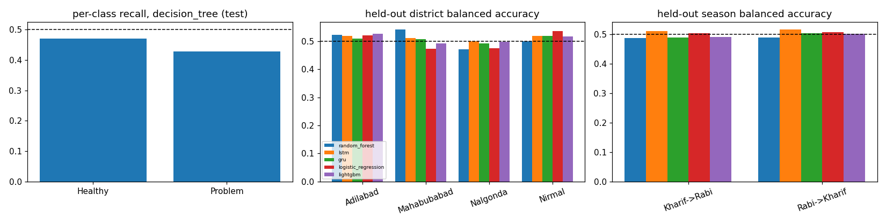
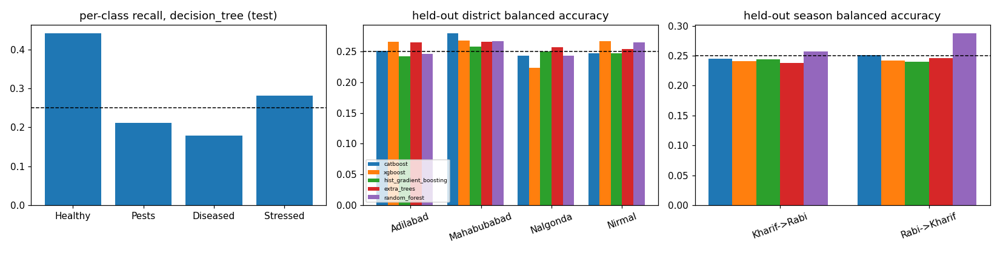
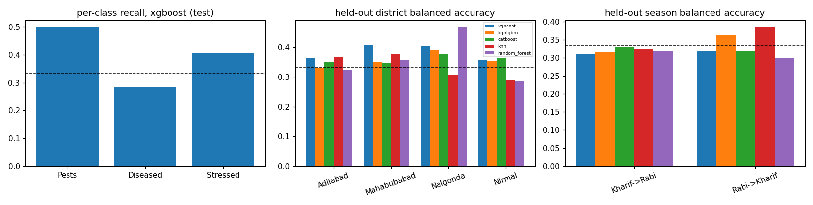
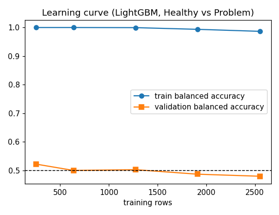

# Validation report

## How the splits protect against leakage

* Main split 70 / 15 / 15 by field: train 2550, validation 547, test 547. Every row is one field (FarmID unique, checked), stratified by label and crop. Assertions in `create_data_splits.py` and `test_ml_pipeline.py` fail on any overlap.
* Scalers and imputers are fitted inside each model on training rows only. Optuna sees training rows only. Model selection reads validation and held-out numbers, never the test split (unit-tested).
* Neighbouring fields in one district share weather and soil, so the main split is **optimistic**. The district-held-out and season-held-out fits below are the honest generalisation tests.
* Leave-one-district-out on ['Adilabad', 'Nirmal', 'Nalgonda', 'Mahabubabad'] (test sizes {'Adilabad': 1226, 'Nirmal': 908, 'Nalgonda': 430, 'Mahabubabad': 423}); season-held-out Rabi to Kharif and Kharif to Rabi ({'Rabi->Kharif': [2891, 753], 'Kharif->Rabi': [753, 2891]}). Year-held-out is impossible (99% of fields were sown in 2023). Districts with fewer than about 150 fields stay in training and are not scored alone.

## Healthy vs Problem

**Healthy vs Problem**: the model ranked highest by the composite score is **decision_tree** (validation macro-F1 0.472, balanced accuracy 0.568, 95% interval 0.521 to 0.626; chance is 0.50; test balanced accuracy 0.449); on held-out districts and the other season it averages 0.503 balanced accuracy. It does **not** clear the pre-registered bar (the validation interval includes chance or held-out balanced accuracy is not at least chance + 0.03), so it is reported as the top-ranked attempt, not as a winner. When every model sits at chance, the ranking mostly reflects speed, size and validation noise. The always-answer-the-commonest-class baseline scores macro-F1 0.451 and accuracy 0.821 on the test split.

Chance balanced accuracy: 0.50. Validation balanced accuracy with 95% bootstrap interval, then held-out scores (balanced accuracy):

| Model | Val Bal. Acc (95% CI) | Test Bal. Acc | Mean held-out Bal. Acc | Eligible |
|---|---|---|---|---|
| random_forest | 0.543 (0.504 to 0.590) | 0.499 | 0.502 | no |
| lstm | 0.552 (0.498 to 0.610) | 0.558 | 0.512 | no |
| gru | 0.526 (0.472 to 0.571) | 0.539 | 0.503 | no |
| logistic_regression | 0.542 (0.488 to 0.592) | 0.524 | 0.503 | no |
| lightgbm | 0.492 (0.448 to 0.532) | 0.489 | 0.505 | no |
| mlp | 0.496 (0.448 to 0.541) | 0.487 | 0.483 | no |

Per-district and per-crop test scores for the strongest attempt (`decision_tree`) are in `reports/ml/results.json` under `per_district_test` / `per_crop_test` of the run files (`.local/ml/runs/main/health_binary/decision_tree.json`).

## Healthy / Pests / Diseased / Stressed

**Healthy / Pests / Diseased / Stressed**: the model ranked highest by the composite score is **decision_tree** (validation macro-F1 0.242, balanced accuracy 0.313, 95% interval 0.253 to 0.385; chance is 0.25; test balanced accuracy 0.278); on held-out districts and the other season it averages 0.270 balanced accuracy. It does **not** clear the pre-registered bar (the validation interval includes chance or held-out balanced accuracy is not at least chance + 0.03), so it is reported as the top-ranked attempt, not as a winner. When every model sits at chance, the ranking mostly reflects speed, size and validation noise. The always-answer-the-commonest-class baseline scores macro-F1 0.225 and accuracy 0.821 on the test split.

Chance balanced accuracy: 0.25. Validation balanced accuracy with 95% bootstrap interval, then held-out scores (balanced accuracy):

| Model | Val Bal. Acc (95% CI) | Test Bal. Acc | Mean held-out Bal. Acc | Eligible |
|---|---|---|---|---|
| catboost | 0.270 (0.240 to 0.304) | 0.239 | 0.253 | no |
| xgboost | 0.289 (0.239 to 0.343) | 0.236 | 0.251 | no |
| hist_gradient_boosting | 0.256 (0.229 to 0.293) | 0.248 | 0.247 | no |
| extra_trees | 0.249 (0.222 to 0.280) | 0.249 | 0.254 | no |
| random_forest | 0.242 (0.215 to 0.278) | 0.260 | 0.261 | no |
| decision_tree | 0.313 (0.253 to 0.385) | 0.278 | 0.270 | no |

Per-district and per-crop test scores for the strongest attempt (`decision_tree`) are in `reports/ml/results.json` under `per_district_test` / `per_crop_test` of the run files (`.local/ml/runs/main/health_4class/decision_tree.json`).

## Cause among problem fields (Pests / Diseased / Stressed)

**Cause among problem fields (Pests / Diseased / Stressed)**: the model ranked highest by the composite score is **xgboost** (validation macro-F1 0.456, balanced accuracy 0.456, 95% interval 0.370 to 0.570; chance is 0.33; test balanced accuracy 0.397); on held-out districts and the other season it averages 0.361 balanced accuracy. It does **not** clear the pre-registered bar (the validation interval includes chance or held-out balanced accuracy is not at least chance + 0.03), so it is reported as the top-ranked attempt, not as a winner. When every model sits at chance, the ranking mostly reflects speed, size and validation noise. The always-answer-the-commonest-class baseline scores macro-F1 0.186 and accuracy 0.388 on the test split.

Chance balanced accuracy: 0.33. Validation balanced accuracy with 95% bootstrap interval, then held-out scores (balanced accuracy):

| Model | Val Bal. Acc (95% CI) | Test Bal. Acc | Mean held-out Bal. Acc | Eligible |
|---|---|---|---|---|
| xgboost | 0.456 (0.370 to 0.570) | 0.397 | 0.361 | no |
| lightgbm | 0.403 (0.326 to 0.489) | 0.412 | 0.350 | no |
| catboost | 0.401 (0.312 to 0.492) | 0.412 | 0.347 | no |
| knn | 0.399 (0.309 to 0.495) | 0.360 | 0.341 | no |
| random_forest | 0.367 (0.280 to 0.470) | 0.400 | 0.342 | no |
| lstm | 0.360 (0.260 to 0.448) | 0.332 | 0.333 | no |

Per-district and per-crop test scores for the strongest attempt (`xgboost`) are in `reports/ml/results.json` under `per_district_test` / `per_crop_test` of the run files (`.local/ml/runs/main/stress_cause/xgboost.json`).

## Sanity checks: do the inputs carry signal, and do the labels?

* Real labels, LightGBM, fixed settings: validation ROC-AUC 0.499, leave-one-district-out ROC-AUC 0.502.
* Same model with the **training labels shuffled**: validation ROC-AUC 0.491. A pipeline without leakage scores about 0.5 here.
* The **same input features predicting crop type** (a label that is visible from space; the crop columns were removed from the inputs): validation accuracy 0.861 against 0.298 for always guessing the commonest crop (7 crops). The inputs clearly carry signal (crop type is read far above chance) while the health labels are read at chance, so the limit is the labels, not the features or the code.

### Which inputs matter (Healthy vs Problem, LightGBM)

| Inputs | Val ROC-AUC | Val Bal. Acc | Leave-one-district-out ROC-AUC | Leave-one-district-out Bal. Acc |
|---|---|---|---|---|
| satellite_only | 0.481 | 0.469 | 0.497 | 0.495 |
| satellite+crop_season | 0.533 | 0.493 | 0.495 | 0.503 |
| satellite+weather | 0.494 | 0.452 | 0.508 | 0.511 |
| satellite+crop_season+weather (main) | 0.499 | 0.499 | 0.500 | 0.509 |
| field_record_only (survey columns, not in the app) | 0.493 | 0.516 | 0.499 | 0.510 |
| all + field_record | 0.520 | 0.508 | 0.506 | 0.511 |

Learning curve (LightGBM, Healthy vs Problem): validation balanced accuracy stays between 0.480 and 0.522 from 255 to 2550 training rows, while training balanced accuracy reaches 0.987. The model memorises the training rows and learns nothing that transfers, so more data with these labels would not be expected to help.

